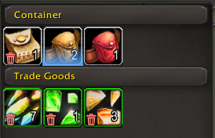
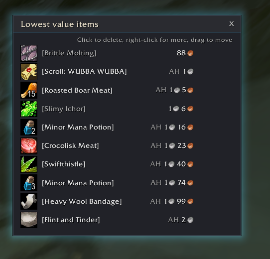
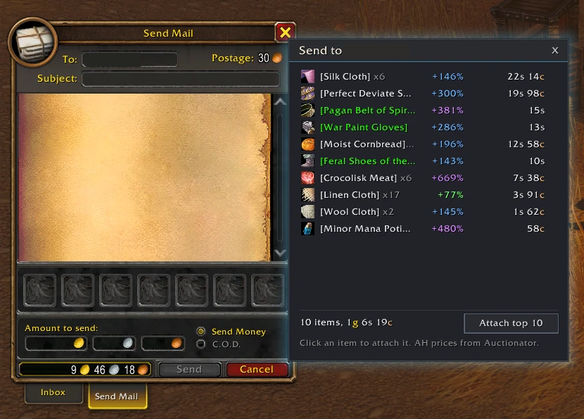
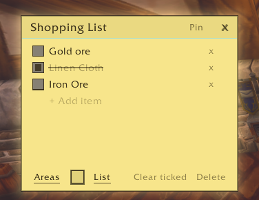
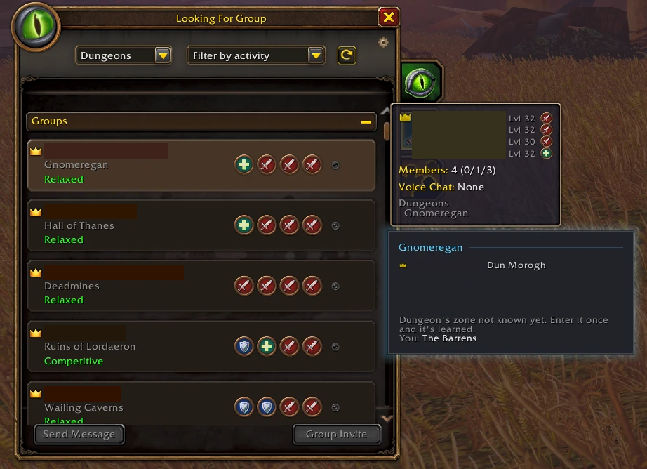
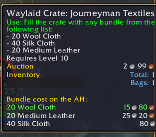
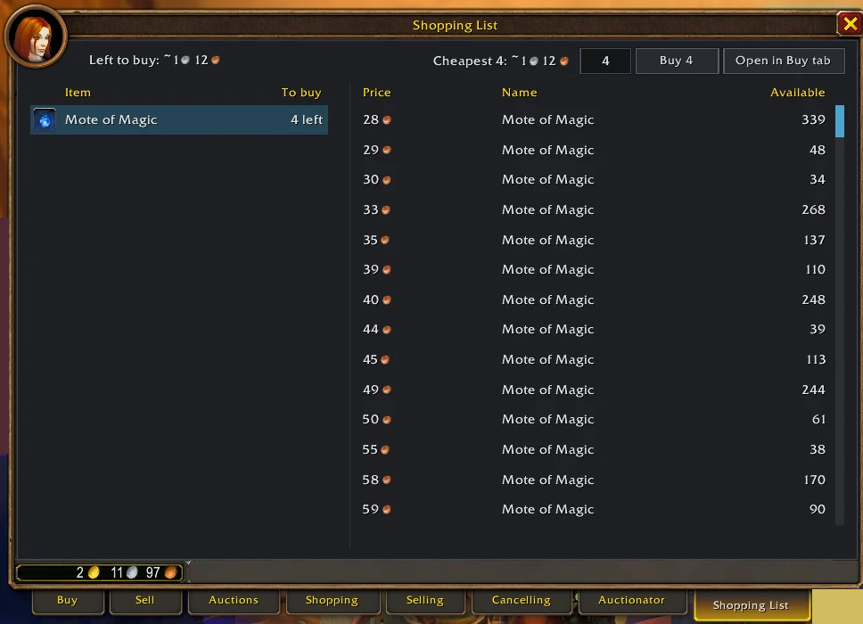
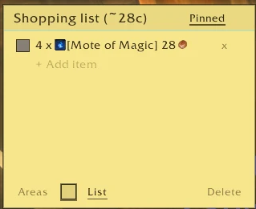

# PredUI

A collection of small quality-of-life addons for **World of Warcraft: Forever** (interface 16001), bundled as one addon with one settings menu and a shared look.

Every part is a module you can turn on or off. Open the settings with `/predui` (or Esc → Options → AddOns → PredUI), or left-click the PredUI minimap button.

The PredUI floating button (drag it anywhere) opens a row of icons for the PredUI windows: Notes, Loot Room, Mail Ledger, Worth sending, Icon Search, the Group Finder and the settings. Right-click it for the settings. Hide it in the settings or with `/predui button`.


## Modules

| Module | What it does | Command |
|---|---|---|
| **Flight Timer** | A faction-coloured bar counting down your flight. Learns each route's real time the first time you fly it. | `/flighttimer` |
| **Craft Timer** | Shows how long a bulk craft will take, and a countdown bar while it runs. Learns each recipe's real time. | `/crafttimer` |
| **Cast Bars** | PredUI bars for your own, your target's and your focus's casts, in place of Blizzard's. Move and snap them in Edit Mode. | `/castbars` |
| **Breath Bar** | Flight Timer's bar for breath under water, fatigue in deep water and feign death, in place of Blizzard's small bars. | `/breathbar` |
| **Swing Timer** | Bars counting down to your next main hand, off hand and ranged swing, in place of Blizzard's own. Shows when your target is out of range, marks the ranged wind-up so you know when to stop moving, and tells hunters and wand users whether their target is in range, how far it is and how close they need to be. Their ranged bar shows as soon as they target an enemy. Move and snap the bars in Edit Mode. | `/swingtimer` |
| **Bag Value** | Shows the vendor sell value of each item on its icon in your bags and bank, plus the total for your bags. | `/bagvalue` |
| **Bank Alt** | Marks what's worth sending to your bank alt: BoE items, valuable items, trash, soulbound and quest items (see below). | `/bankalt` |
| **Icon Search** | Search every macro icon by name or file ID and apply it to a macro or equipment set. | `/iconsearch` |
| **Loot Room** | When your bags are full, shows your lowest-value items next to the loot window so you can free a slot, by vendor or AH price. `/lootroom show` lists them any time, to clear out junk (see below). | `/lootroom` |
| **Mail Ledger** | Shows how much gold you looted from the mailbox, where it came from and what is still waiting, including sold auctions whose mail is still on its way. Can open the mailbox on Send Mail, addressed to your default alt, with a list of what's worth sending by AH value. | `/mledger` |
| **Hidden Settings** | Game settings that aren't in the Options menu: denser grass, longer foliage distance, weather, screen effects and more. | `/hiddensettings` |
| **Paladin Buffs** | Shows your active seal next to the Cooldown Manager's buff icons (flashing and glowing as it runs out or when it's missing in combat), and a Righteous Fury reminder in dungeons, raids, and groups when you have a shield on. | `/palbuffs` |
| **Notes** | Post-it notes and checklists for reminders. Keep a list of notes, pin one to keep it on screen, or have it open by itself when you enter a zone or any capital city. The Notes icon on the PredUI floating button opens the list. | `/notes` |
| **Party Locations** | On the Group Finder's Browse tab, shows where a listed group's leader is and whether they're at the dungeon, and filters the list by group size, solo players, open role slots and text. | `/partyloc` |
| **Invite Whispers** | When someone whispers you for an invite ("inv", "invite"...), lists them with their level and class, and Invite and Who buttons. Known levels are also put in front of the whisper in chat. | `/invwhisper` |
| **Hidden Stats** | A panel beside the character sheet (C) with stats the sheet doesn't show: movement speed that follows what you're doing (running, swimming, mounted, flight path), mana or energy regen, attack speed, average item level and durability. Hover a row for the details. | `/hstats` |
| **Questie Zones** | Orders the zones in Questie's quest tracker by distance, nearest first, instead of alphabetically. Needs Questie. | `/qzones` |
| **Crate Prices** | On Waylaid Crates and other items you fill with "any bundle from the list", shows what each bundle costs on the AH, cheapest first. Needs Auctionator. | `/crates` |
| **Craft Cost** | Beside the Professions window: is it cheaper to buy the item, or buy the materials (bars, ore...) and craft it? Add any option to a shopping list post-it, also shown in the Auction House, where you can click an item to search and buy it. The list shrinks as items reach your bags. A Flipping window lists what you can craft and sell at a profit. Needs Auctionator. | `/craftcost`, `/flip` |

### Bank Alt

Marks items in your bags and bank so you can see at a glance what to mail to your bank alt:

- **Glow** on Bind on Equip items that aren't soulbound yet (colour of your choice; optionally Bind on Use too).
- **Valuable** items (the Auctionator price is at least a set % above the vendor price, +50% by default) get a coin, a glow along the bottom of the icon, or both. The colour shows how much more the auction house pays: green, blue (+100%), purple (+300%), orange (+1000%).
- **Trash can** on items whose auction house price is barely above the vendor price (under +20% by default): just vendor them.
- **Padlock** on soulbound items and a **scroll** on items your current quests need.
- **Baganator Quest category:** items with the scroll are sorted into Baganator's Quest category, and taken out again once you hand the quest in (can be turned off in the settings).
- An **"AH vs vendor"** line in item tooltips, under Auctionator's prices.
- Items cheaper than a minimum auction house price (10c by default) are left alone.
- Grey (poor) items never count as valuable: their AH price is ignored everywhere in PredUI.
- `/bankalt list` prints everything in your bags worth sending, with the total.
- **Ignore** an item (a profession tool you will never sell, say) with Ctrl+Alt+right-click in your bags: it gets no marks at all. Do it again to undo; `/bankalt ignored` lists them.
- The same marks show on the item icons in **Auctionator's Selling tab** at the auction house.

  


### Loot Room

When you loot with full bags, a window next to the loot window lists your lowest-value items, and says whether each loot item is worth more (Better / Same / Worse) than the cheapest of them.

- **Value by** vendor price, Auctionator price, or the higher of the two (`/lootroom sort vendor|ah|best`). Prices from the auction house are marked "AH". Soulbound items, grey items, and items Auctionator has no price for use the vendor price.
- **List any time** with `/lootroom show` (or "Show list" in the settings) to clear out junk without looting. Drag that window wherever you like; `/lootroom reset` puts it back.
- **Quest turn-ins:** the list also opens by itself when a quest can't be turned in because your bags are full (can be turned off in the settings).
- "Items shown" sets how many rows the window has; scroll (bar or mouse wheel) to see the rest of your items, cheapest first.
- Click an item to delete it (it asks first). Right-click for "Never offer this item"; `/lootroom unhide` offers them again.
- **Loot after deleting:** delete an item while the loot window is open and the freed slot is filled straight away: quest loot first, then the most valuable loot worth more than what you deleted. Loot that stacks onto what you already have is taken too, and items being rolled on are left alone (can be turned off in the settings).
- Quest items and items in profession bags are never listed. Loot that fits onto a stack you already have doesn't open the window.



### Mail Ledger

 

**Sold, mail on its way** lists auctions that have sold but whose gold hasn't reached the mailbox yet (it lands an hour after the sale), with what you get after the AH cut and a countdown. It covers every character on the realm, with alts' rows tagged by name, so you can follow your bank alt from your main. An alt's sales only appear once that alt has seen them (logged in when they sold, or its next AH visit).
- A sale is caught the moment it happens, wherever you are, and a chat line says what sold and for how much (turn it off with `/mledger salechat`).
- Prices come from your listings, which PredUI reads each time you open the AH, so open it once after posting.
- Sales made while you were offline are found the next time you open the AH: a listing that's gone before its time could run out, and that you didn't cancel, has sold. When exactly is unknown, so the list shows the latest its mail can land ("by 14:32").
- The AH cut is learned from your sale mails (5% until the first one). The deposit you get back isn't included.
- `/mledger sales` prints the list, the minimap tooltip shows the total for each character, and `/mledger testsale` adds a test row.

**Worth sending** opens with the mailbox and lists the items in your bags worth sending to your bank alt, most valuable stack first (Auctionator price x count), with how far each AH price is above or below the vendor price.
- Sorted by the stack's gold value by default, or by % over vendor (setting "Sort worth-sending by", or `/mledger sort`).
- Click an item to attach it to the mail; **Attach top N** fills the mail's free slots.
- Ctrl+Alt+right-click an item to never suggest it (the same ignore list as Bank Alt, so ignoring it in your bags removes it from the list straight away).
- It follows Bank Alt's rules: no soulbound, ignored or quest items, nothing under its Min AH price. Items with no AH price aren't listed.
- Not shown on the bank alt itself. `/mledger list` shows or hides it.



### Flight Timer

Hover a destination at a flight master to see its flight time in the tooltip: the learned time once you've flown the route, or a `~` estimate until then (turn it off in the settings).


### Notes

Post-it notes in four paper colours, with a list of all your notes. The Notes icon on the PredUI floating button opens it (right-click for a new note).

- **Pin** a note to keep it on screen, also after a reload.
- **Checklists** for shopping lists and the like: "New list" (or "List" on a note, which turns its lines into items). Tick items off, "Clear ticked" removes them.
- **Tags**: type `@` and part of a quest name, or `#` and part of an item name, to pick it from a list. Tab or Enter puts it in the note, and it becomes a link when you click away. Backspace removes a whole tag at once. Click a quest to open it in your quest log, or if you don't have it, to set a map waypoint where it starts (needs Questie). Items show their icon and AH price (needs Auctionator); click one for its tooltip. In the chat box, `@` or `#` and two letters do the same and put in a real link.
- **Areas**: a note can open by itself when you enter a zone, a subzone or any capital city.
- New notes are only seen by the character that wrote them; untick "Only on ..." under Areas to share one with all your characters.
- Drag a note by its title to move it.

 



## Works with

All optional; PredUI runs without them.

- [Baganator](https://www.curseforge.com/wow/addons/baganator): Bank Alt hooks Baganator's bag, bank and other-character views. Its coin/trash, padlock and quest scroll are Baganator corner icons you can move in Baganator's icon settings.
- [Auctionator](https://www.curseforge.com/wow/addons/auctionator): auction prices for Bank Alt, the tooltip line and Loot Room's AH sorting. Bank Alt also marks the items in its Selling tab.

## Install

Clone or download this repository into your Forever AddOns folder so the files end up in `World of Warcraft\_forever_\Interface\AddOns\PredUI`:

```
cd "World of Warcraft/_forever_/Interface/AddOns"
git clone https://github.com/AdamSai/PredUI.git
```

Restart the game (not just `/reload`) after the first install or when new images are added.

Turning a module on or off takes a `/reload`, because modules hook the game's own windows and hooks can't be removed again.

## Moving from the old standalone addons

Flight Timer, Craft Timer, Bag Value, Icon Search, Loot Room and Mail Ledger used to be separate addons. With the game closed, `node Tools/migrate.js` copies their saved data into PredUI's saved variables.

### Party Locations

On the Group Finder's Browse tab, a list of a group's members and the zone its leader is in, so you can see whether they're at the dungeon before you ask to join.

- It shows the group under the mouse (just below Blizzard's group tooltip), or the selected group, in a panel beside the Group Finder.
- The leader is marked **inside** (in the dungeon), **here** (in its zone) or **away**. Below that is the zone you're in yourself.
- Only the leader's zone is shown: the game doesn't share the other members' zones with the Group Finder.
- Forever doesn't tell addons which zone a dungeon is in, so PredUI learns it: each time you enter a dungeon, the zone you came from is counted for it. Until then the panel lists zones without marks. `/partyloc zones` shows what's known, `/partyloc forget` clears it.
- `/partyloc test` shows the panel with a made-up group.

**Filters.** A bar under the Group Finder hides listings you don't want:

- **Players** min to max: only groups of that size (leave a box empty for no limit).
- **No solo**: hide single players looking for a group.
- **My role**: only groups with an open slot for a role you ticked in the Group Finder.
- **Search**: only groups whose leader, title or comment has all the words you type. If the game hides titles and comments from addons, only leader names are searched (`/partyloc filters` tells you which).
- **Clear** turns every filter off. The bar shows how many groups are hidden.
- Your own listing is never hidden, and a group the game won't tell us about stays shown.
- The same filters are on the settings page, where you can also hide the bar. `/partyloc filters` lists them and `/partyloc clear` clears them.



### Invite Whispers

When someone whispers you something like "inv", "inv pls" or "invite?", a small **Invite requests** window lists them (newest on top, up to 6, for 5 minutes):

- Their **level** (coloured by difficulty) and **class colour**. The class comes from the whisper itself.
- The level is filled in from what the game already knows: your group, friends, guild, groups listed in the Group Finder, and /who results from this session. When none of those know them, it shows **?** and a **Who** button. The game only lets addons send /who from a click, so it never looks people up on its own.
- **Invite** invites them. They leave the list once they're in your group.
- When the level is known, the whisper in chat gets it in front, like `[32] inv pls`.
- Words like "invisible" or "inventory" don't count. Whispers the game hides from addons (chat lockdown in combat) are left alone.
- `/invwhisper` opens the list, `/invwhisper test` shows made-up requests, `/invwhisper clear` empties it. Drag the title to move it.

### Hidden Stats

A small panel on the right of the character sheet (C), on the Character tab.

- **Movement speed** changes with what you're doing: run, swim, mounted, flying or flight path speed, updated live. Hover it for every speed at once (moving now in % and yards a second, run, swim, mounted).
- **Mana regen** per 5 seconds (hover: not casting and while casting), or **energy regen** per second for energy users.
- **Attack speed** of your main hand / off hand, plus ranged in the tooltip, with attacks per second.
- **Item level**: average of your equipped gear.
- **Durability**: overall % of your gear, coloured by your most worn item on a smooth scale: green at 100%, yellow at 50%, red at 20% or below, blending in between. Hover it for every damaged item, worst first.
- In combat the game can hide some of these values from addons; the row shows "-" until they're back.
- `/hstats toggle` hides or shows the panel, `/hstats test` shows it with made-up values.

### Questie Zones

Questie's "By Zone" tracker sortings list zones A-Z ("By Zone Prox" only sorts the quests inside each zone). This module puts the nearest zone first.

- A zone's distance is its nearest quest's: the nearest unfinished objective, or the turn-in NPC once the quest is complete (the same measure Questie's proximity sorting uses).
- Zones on another continent come after this one; zones Questie has no location for go last.
- Quests inside each zone keep Questie's order. The order updates as you travel (every 5 seconds, only redrawn when it changes).
- Works with Questie's By Zone, By Zone Prox and By Zone Prox (Reversed) sortings. Questie's own files aren't changed, so Questie updates keep it.
- `/qzones show` lists the zones with their distance, `/qzones on` / `off` turns sorting on or off.

### Crate Prices

Hover a Waylaid Crate (or anything else that lists bundles like "- 20 Soul Dust") and a "Bundle cost on the AH" block is added under it:



- Each bundle's cost at Auctionator's last-scanned price, sorted cheapest first; the cheapest is green.
- Items you already have in your bags and bank are taken off the cost ("have 2"); a bundle you already have is marked "you have them".
- Prices 3 or more days old show their age, so you know to rescan.
- The tooltip only has item names, and Auctionator keeps its prices by item ID. Names are matched through your bags, the game's item cache and Auctionator's price list; names the game doesn't have yet are looked up in the background ("looking up..." for a second or two), then the tooltip updates. "Not in Auctionator yet" means it has never seen that item on the AH: do a scan.
- `/crates test` shows a sample crate tooltip, `/crates items` lists the matched names, `/crates reset` forgets them.

### Craft Cost

Is it cheaper to buy something, or to buy the materials and make it yourself? Open each of your professions once so its recipes are saved, and scan the AH with Auctionator for prices.

- **Beside the Professions window:** the selected recipe's options for the Amount you set: buy it, make it from bought materials, make it from raw materials (ore instead of bars), and the cheapest mix. Materials in your bags are used first; turn off "Use items in my bags" for full market prices. **Hide costs** hides the panel.
- **Shopping list:** **Add** puts an option's materials on a pinned post-it. It shrinks as items reach your bags, and a line ticks itself when it's done. Auction House buys count when you collect the mail.
- **Shopping List tab in the Auction House:** click an item to see what's on sale, cheapest first, and buy from there. Stacked items have one **Buy** with an amount box; single auctions have a **Buy** on each row. Every purchase shows a confirm box with the final price.
- **Flipping window:** `/flip` lists what you can craft and sell for more than it costs, after the AH cut, at market prices. It can't tell how fast something sells, so check a listing before making a big batch.

 

`/craftcost` opens the settings, `/craftcost toggle` shows or hides the panel, `/craftcost test` previews it with made-up prices, `/craftcost reset` puts it back in place and `/craftcost forget` clears saved recipes and vendor prices.
