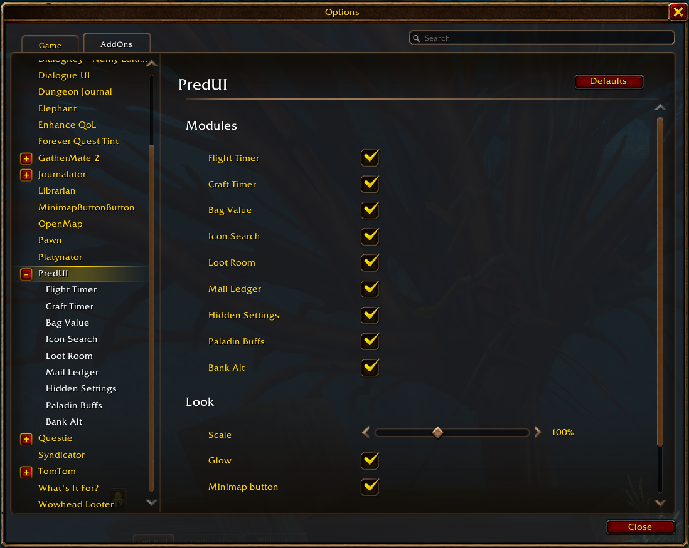
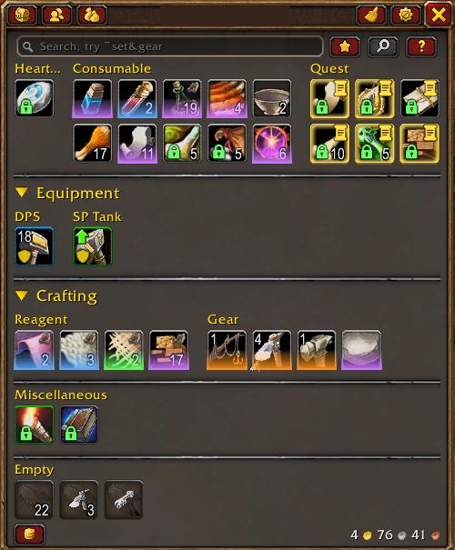
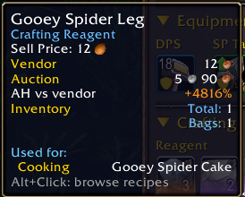
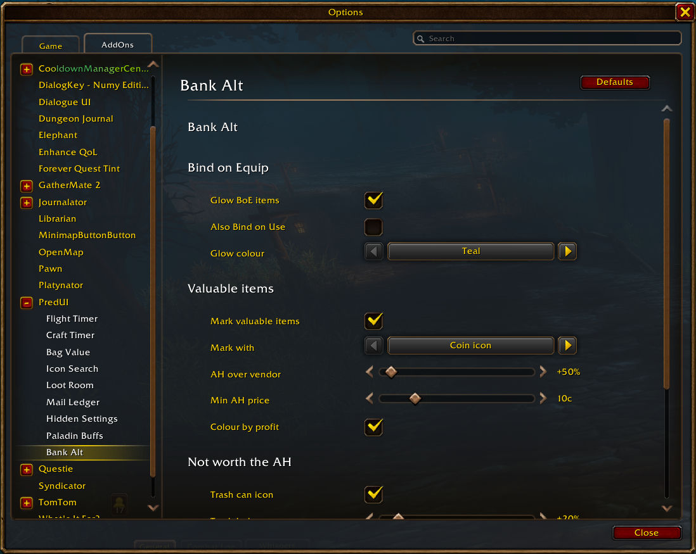
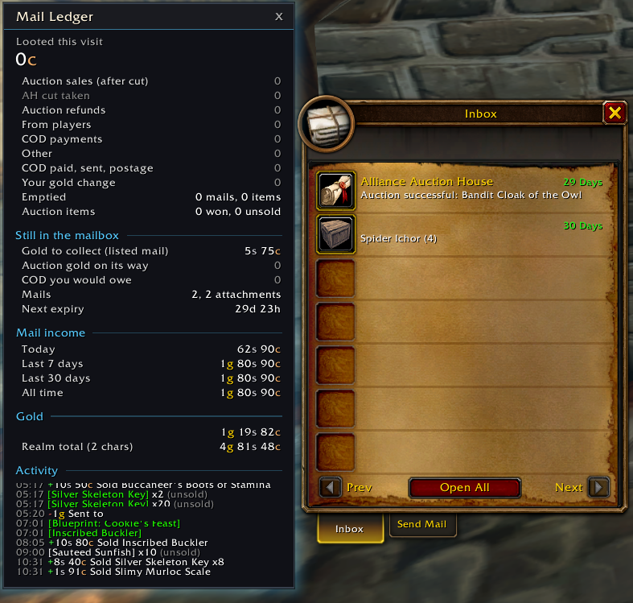
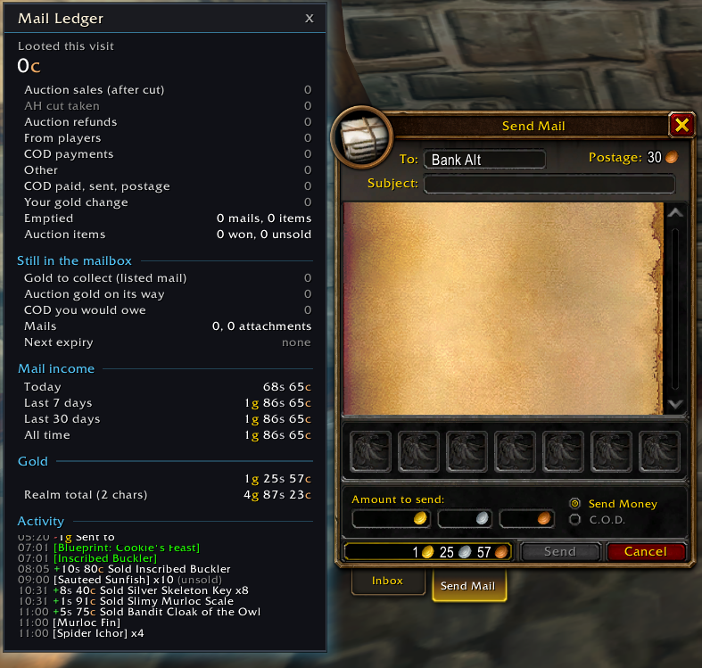
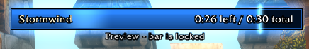
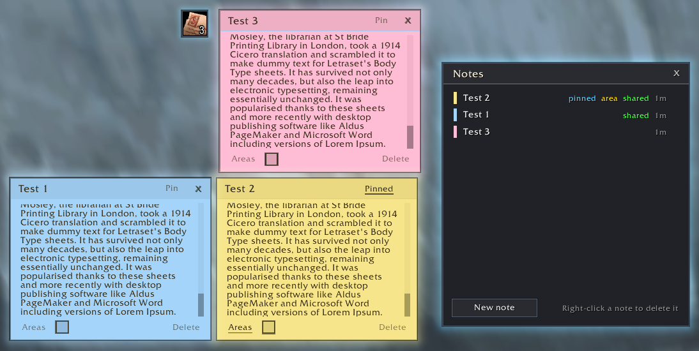
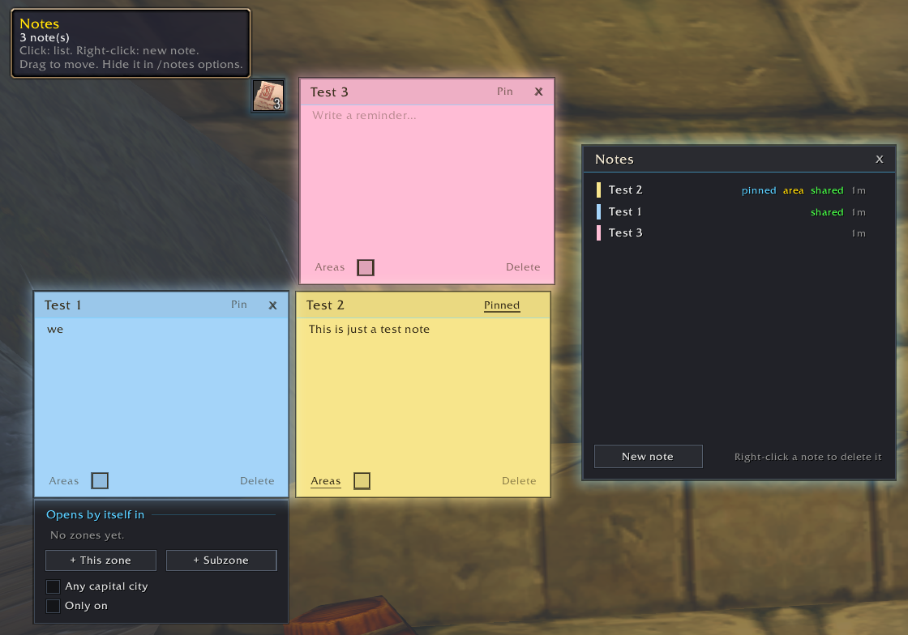

# PredUI

A collection of small quality-of-life addons for **World of Warcraft: Forever** (interface 16001), bundled as one addon with one settings menu and a shared look.

Every part is a module you can turn on or off. Open the settings with `/predui` (or Esc → Options → AddOns → PredUI), or left-click the PredUI minimap button.



## Modules

| Module | What it does | Command |
|---|---|---|
| **Flight Timer** | A faction-coloured bar counting down your flight. Learns each route's real time the first time you fly it. | `/flighttimer` |
| **Craft Timer** | Shows how long a bulk craft will take, and a countdown bar while it runs. Learns each recipe's real time. | `/crafttimer` |
| **Bag Value** | Shows the vendor sell value of each item on its icon in your bags and bank, plus the total for your bags. | `/bagvalue` |
| **Bank Alt** | Marks what's worth sending to your bank alt: BoE items, valuable items, trash, soulbound and quest items (see below). | `/bankalt` |
| **Icon Search** | Search every macro icon by name or file ID and apply it to a macro or equipment set. | `/iconsearch` |
| **Loot Room** | When your bags are full, shows your lowest-value items next to the loot window so you can free a slot. | `/lootroom` |
| **Mail Ledger** | Shows how much gold you looted from the mailbox, where it came from and what is still waiting. Can open the mailbox on Send Mail, addressed to your default alt. | `/mledger` |
| **Hidden Settings** | Game settings that aren't in the Options menu: denser grass, longer foliage distance, weather, screen effects and more. | `/hiddensettings` |
| **Paladin Buffs** | Shows your active seal next to the Cooldown Manager's buff icons (flashing and glowing as it runs out or when it's missing in combat), and a Righteous Fury reminder in dungeons, raids, and groups when you have a shield on. | `/palbuffs` |
| **Notes** | Post-it notes for reminders. Keep a list of notes, pin one to keep it on screen, or have it open by itself when you enter a zone or any capital city. A floating button (optional) opens the list. | `/notes` |

### Bank Alt

Marks items in your bags and bank so you can see at a glance what to mail to your bank alt:

- **Glow** on Bind on Equip items that aren't soulbound yet (colour of your choice; optionally Bind on Use too).
- **Valuable** items (the Auctionator price is at least a set % above the vendor price, +50% by default) get a coin, a glow along the bottom of the icon, or both. The colour shows how much more the auction house pays: green, blue (+100%), purple (+300%), orange (+1000%).
- **Trash can** on items whose auction house price is barely above the vendor price (under +20% by default): just vendor them.
- **Padlock** on soulbound items and a **scroll** on items your current quests need.
- An **"AH vs vendor"** line in item tooltips, under Auctionator's prices.
- Items cheaper than a minimum auction house price (10c by default) are left alone.
- `/bankalt list` prints everything in your bags worth sending, with the total.

 



### Mail Ledger

 

### Flight Timer



### Notes

Post-it notes in four paper colours, with a list of all your notes and a floating button to open it.

- **Pin** a note to keep it on screen, also after a reload.
- **Areas**: a note can open by itself when you enter a zone, a subzone or any capital city.
- New notes are only seen by the character that wrote them; untick "Only on ..." under Areas to share one with all your characters.
- Drag a note by its title to move it.

 

## Works with

All optional; PredUI runs without them.

- [Baganator](https://www.curseforge.com/wow/addons/baganator): Bank Alt hooks Baganator's bag, bank and other-character views. Its coin/trash, padlock and quest scroll are Baganator corner icons you can move in Baganator's icon settings.
- [Auctionator](https://www.curseforge.com/wow/addons/auctionator): auction prices for Bank Alt and the tooltip line.

## Install

Clone or download this repository into your Forever AddOns folder so the files end up in `World of Warcraft\_forever_\Interface\AddOns\PredUI`:

```
cd "World of Warcraft/_forever_/Interface/AddOns"
git clone https://github.com/AdamSai/PredUI.git
```

Restart the game (not just `/reload`) after the first install or when new images are added.

Turning a module on or off takes a `/reload`, because modules hook the game's own windows and hooks can't be removed again.

## Moving from the old standalone addons

Flight Timer, Craft Timer, Bag Value, Icon Search, Loot Room and Mail Ledger used to be separate addons. With the game closed, `node Tools/migrate.js` copies their saved data into PredUI's saved variables.
